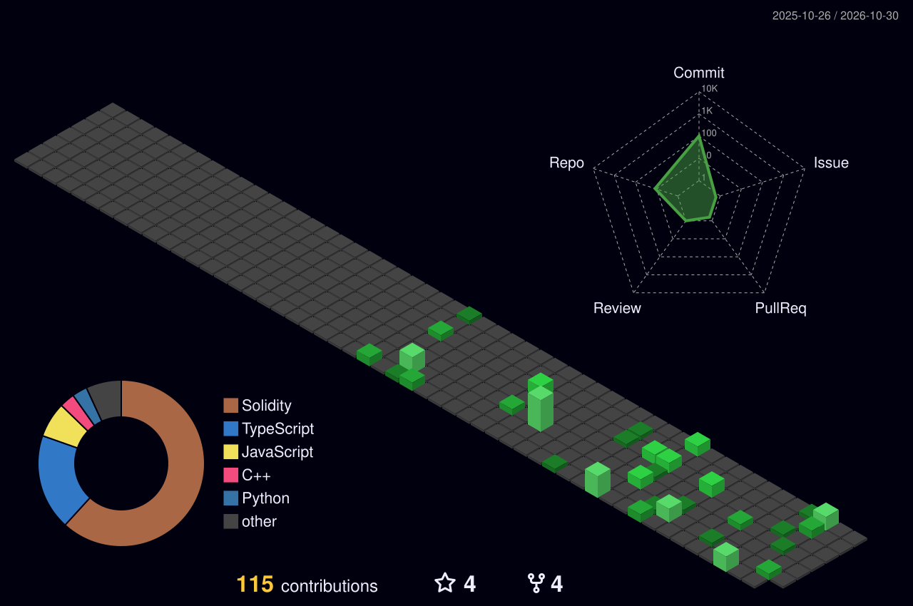

<!-- ═════════════ BANNER ═════════════ -->
<p align="center">
  
</p>

<p align="center">
  
</p>

<p align="center">
  
</p>

<!-- ═════════════ ABOUT ME ═════════════ -->
## 🎯 About Me

<table>
<tr>
<td width="52%" valign="top">

```javascript
const ainhoa = {
  location: "Spain 🇪🇸",

  building: [
    "Smart contract audits",
    "Exploit PoCs with Foundry",
    "Home SOC lab (Wazuh)",
    "ESP32-S3 hardware hacking",
  ],

  learning: [
    "MSc Blockchain Dev - DeFi Security",
    "CCNA", "CyberOps Associate",
    "C|PENT", "Bug bounty",
  ],

  certs: ["CRTOM", "CCST"],

  tools: {
    web3:      ["Foundry", "Remix", "Slither"],
    offensive: ["Kali", "Nmap", "Wireshark"],
    defensive: ["Wazuh", "OpenSearch", "pfSense"],
  },
};
```

<table><tr><td>
<p align="center"><i>"Security is a process, not a product."</i><br/><sub>— Bruce Schneier</sub></p>
</td></tr></table>

</td>
<td width="48%" align="center" valign="middle">
  
</td>
</tr>
</table>

<!-- ═════════════ CONNECT ═════════════ -->
## 📬 Connect With Me

<p align="center">
  <a href="https://www.linkedin.com/in/ainhoa-l%C3%B3pez-perell%C3%B3-2351b72ba"></a>
  <a href="https://github.com/Noahlp125/web3-security-portfolio"></a>
  <a href="https://github.com/Noahlp125/foundry-exploit-lab"></a>
</p>

<!-- ═════════════ TECH STACK ═════════════ -->
## 🛠️ Tech Stack

<div align="center">
<table>
<tr>
  <td align="center" width="90"><br/><sub>Solidity</sub></td>
  <td align="center" width="90"><br/><sub>Python</sub></td>
  <td align="center" width="90"><br/><sub>JS</sub></td>
  <td align="center" width="90"><br/><sub>React</sub></td>
  <td align="center" width="90"><br/><sub>Node.js</sub></td>
  <td align="center" width="90"><br/><sub>HTML</sub></td>
  <td align="center" width="90"><br/><sub>CSS</sub></td>
  <td align="center" width="90"><br/><sub>MySQL</sub></td>
</tr>
<tr>
  <td align="center" width="90"><br/><sub>Kali</sub></td>
  <td align="center" width="90"><br/><sub>Linux</sub></td>
  <td align="center" width="90"><br/><sub>Ubuntu</sub></td>
  <td align="center" width="90"><br/><sub>Windows</sub></td>
  <td align="center" width="90"><br/><sub>Bash</sub></td>
  <td align="center" width="90"><br/><sub>PowerShell</sub></td>
  <td align="center" width="90"><br/><sub>Docker</sub></td>
  <td align="center" width="90"><br/><sub>AWS</sub></td>
</tr>
<tr>
  <td align="center" width="90"><br/><sub>Git</sub></td>
  <td align="center" width="90"><br/><sub>GitHub</sub></td>
  <td align="center" width="90"><br/><sub>Actions</sub></td>
  <td align="center" width="90"><br/><sub>VS Code</sub></td>
  <td align="center" width="90"><br/><sub>Arduino</sub></td>
  <td align="center" width="90"><br/><sub>Raspberry</sub></td>
  <td align="center" width="90"><br/><sub>Obsidian</sub></td>
  <td align="center" width="90"><br/><sub>Markdown</sub></td>
</tr>
</table>


<br/>


</div>

<!-- ═════════════ PROJECTS ═════════════ -->
## 🔐 Featured Projects

| | Project | What it is |
|:-:|:--|:--|
| 🧪 | **[foundry-exploit-lab](https://github.com/Noahlp125/foundry-exploit-lab)** | Vulnerable contracts, exploit PoCs and fixes with Foundry |
| 🪙 | **[hackchain-token-contracts](https://github.com/Noahlp125/hackchain-token-contracts)** | Token and presale contracts |
| 🗳️ | **[sistema-votacion-solidity](https://github.com/Noahlp125/sistema-votacion-solidity)** | Voting system: whitelist, time-limited voting, ETH payments |
| 🌐 | **[CRT-Albitrum-Cripto](https://github.com/Noahlp125/CRT-Albitrum-Cripto)** | ERC-20 token deployed on Arbitrum One |
| 🕵️ | **[Web-Security-Audit-on-DVWA](https://github.com/Noahlp125/Web-Security-Audit-on-DVWA)** | Web pentest of DVWA with Docker + Kali Linux |
| 📂 | **[web3-security-portfolio](https://github.com/Noahlp125/web3-security-portfolio)** | Web3 security findings and audit case studies |

<!-- ═════════════ ANALYTICS ═════════════ -->
## 📊 GitHub Analytics

<p align="center">
  
</p>
<p align="center">
  
  
</p>
<p align="center">
  
  
</p>

## 🧊 3D Contributions

<p align="center">
  
</p>

<!-- ═════════════ TROPHIES ═════════════ -->
## 🏆 GitHub Trophies

<p align="center">
  
</p>

<p align="center">
  
</p>
